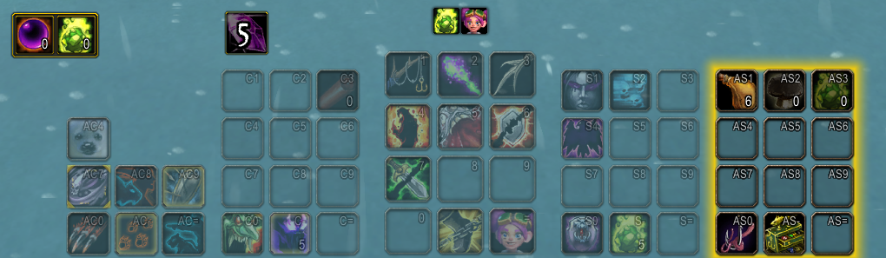

# Hotbar Highlight

[WoW: Forever] A visual aid addon that highlights the hotbar based on the currently pressed modifier key.

It shows which action bar you are on. Hold Shift, Ctrl or Alt and the bar bound to that modifier glows while the others fade.

- Made for the default UI. A custom UI or an action bar addon may not work.
- World of Warcraft Forever, interface 16001.
- Settings open with `/hh`.

## Features

- Finds each bar's modifier from your key bindings. No setup.
- Soft glow or thin line in any color. The other bars fade as much as you set.
- Highlight around the whole bar or only around the visible buttons.
- Short key labels such as `S1` and `AC1`. Move, resize and fade them.
- Bars without key bindings are left alone. Modifiers no bar uses do nothing.
- Edit Mode shows the bars unchanged.
- Visual only.
- Covers Action Bars 1 to 8, the pet bar and the stance bar.

## Settings

Options, AddOns, Hotbar Highlight, or `/hh`.

| Setting | Default | Meaning |
|---|---|---|
| Enabled | on | Off restores bars and key labels to the game's own. |
| Other bars' opacity | 40% | How visible the other bars stay. 100% means no fade. |
| Highlight around the bar | on | Off leaves only the fade. |
| Highlight goes around | the whole bar | Or only the visible buttons. |
| Highlight style | soft glow | Soft glow or thin line. |
| Highlight color | gold | Any color. |
| Highlight opacity | 90% | Strength of the glow or line. |
| Glow size | 18 px | Reach of the glow. |
| Line thickness | 2 px | Thickness of the thin line. |
| Inner glow | 14% | Fills the gaps at the buttons' round corners. 0 turns it off. |
| With no modifier held | every bar normal | Or keep the bar without a modifier highlighted. |
| Only in combat | off | Highlight only during a fight. |
| Key labels | short | Short `S1`, key only `1`, or the game's own `s-1`. |
| Key label place | the game's own | A corner, a side or the center of the button. |
| Key label left/right and down/up | 0 | Offset in pixels. |
| Key label size and opacity | 100% | Relative to the game's own. |
| One choice per bar | auto | Auto, a fixed modifier, or leave the bar alone. |

## Commands

| Command | Does |
|---|---|
| `/hh` | Opens the settings, out of combat. |
| `/hh status` | Lists each bar, its modifier and how many buttons have a key. |
| `/hh on` and `/hh off` | Turns the addon on or off. |

## Install

Download the zip from the [Releases page](https://github.com/Golorom/HotbarHighlight/releases) and unpack it into `World of Warcraft\_forever_\Interface\AddOns\`. The folder must be named `HotbarHighlight`. Restart the game.

No other addon is needed. [BugSack](https://www.curseforge.com/wow/addons/bugsack) with [!BugGrabber](https://www.curseforge.com/wow/addons/bug-grabber) is recommended for error reports.

## Reporting a problem

Open an issue with the output of `/hh status`, the BugSack text if any, and your bars and key bindings.

## Support

Free and open source. Donations are welcome at [boosty.to/goromajur/donate](https://boosty.to/goromajur/donate). With a card issued outside Russia choose USD or EUR at checkout.

## Documentation

- [How it works](docs/HOW-IT-WORKS.md)
- [Development](docs/DEVELOPMENT.md)
- [Changelog](CHANGELOG.md)

## License

MIT. See [LICENSE](LICENSE).
